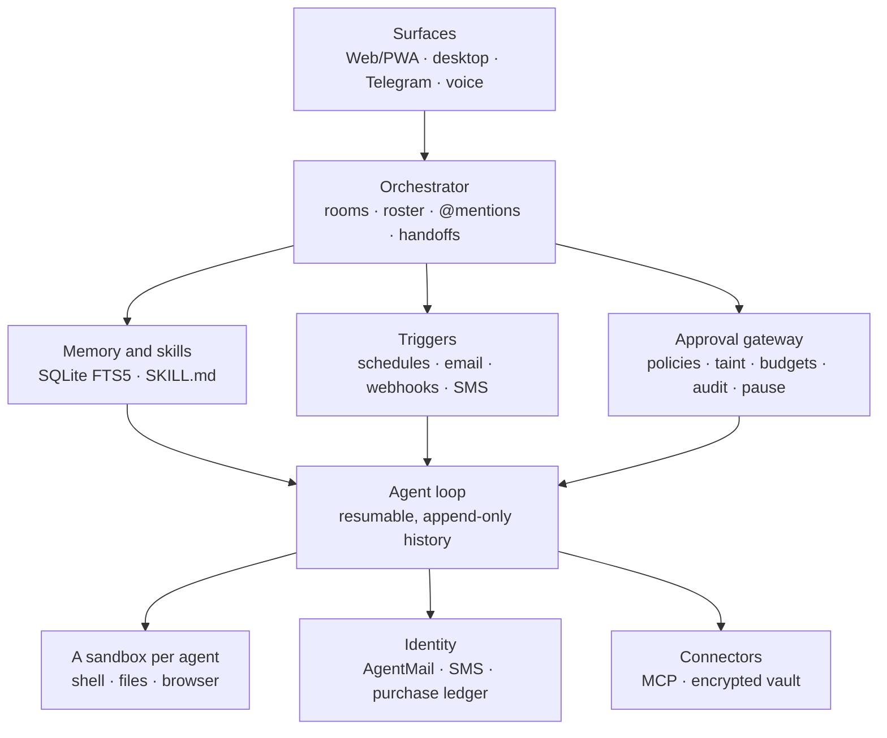

<p align="center">
  
</p>

<h1 align="center">Troupe</h1>

<p align="center"><em>A private household of AI agents. Self-hosted, open source, and comfortable on one 8&nbsp;GB server.</em></p>

---

Troupe gives you a small team of named agents, such as a chief of staff, a researcher and someone to run your inbox and errands. Each one has its own private computer, memory, skills and email address. You talk to them the way you'd talk to capable people: in a room on the web, on your phone, in the desktop app or on Telegram. They plan, hand work to each other, and come back with results. Anything that matters, like sending to someone new, buying or posting, waits for your approval.

It brings together the best ideas from Meta Muse, Manus Cue and xAI Grok Bot, in an open-source project you run yourself. It also shares the open Agent Skills format with Hermes Agent and OpenClaw, so their skills work here.

## What you get

| | |
|---|---|
| **A team, not a chatbot** | Named agents with standing roles, chosen from presets (Personal, Founder, Researcher, Household) or made your own. Group rooms where a lead plans, delegates and reports back, and you make the final call. |
| **A computer for each agent** | Every agent works in its own Docker sandbox (optionally gVisor): shell, files and a real browser that keeps its logins. One agent can't see another's files, and agents can be cut off from the internet entirely. |
| **Skills** | The open Agent Skills format (`SKILL.md`). 20 curated skills included. Install more from GitHub, a link or a zip, with a safety scan before anything is installed. Teach new ones by demonstrating a task once. |
| **Identity** | A real email inbox per agent through AgentMail, or your own mailbox. Optional SMS. Purchases within a weekly budget, always with your approval. |
| **Work that starts on its own** | Schedules ("every weekday at 8"), inbound email, webhooks and texts all become tasks. |
| **Memory** | Long-term memory per agent, pinned facts about you, and handover notes so long conversations never lose the thread. |
| **Safety you can see** | One approval gateway for every action, per-agent permissions, weekly AI and spending budgets, a complete activity log and a pause button. Untrusted content (email, web pages, community skills) locks outbound actions behind your approval, which blunts prompt injection. |
| **Any model** | Claude, OpenAI, Qwen, DeepSeek, Kimi, OpenRouter, local Ollama, or any OpenAI-compatible endpoint. Choose it in the setup wizard and switch at any time without a restart. |
| **Everywhere you are** | A refined web app that installs on your phone, a Windows desktop app with a tray icon and notifications, and Telegram with one-tap approvals. Voice dictation and read-aloud are built in. |

### How it differs

- **From Muse, Cue and Grok Bot:** Troupe runs on your server with your keys, and your data stays with you. Each agent has its own isolated computer rather than sharing one.
- **From Hermes Agent and OpenClaw:** Troupe is built around a *team* working together in rooms, with a lead and handoffs, rather than one assistant. It treats skills from the internet as untrusted by default, scanning them on install, running their scripts only in a sandbox, and requiring approval for any outbound action they lead to. Community skill registries have hosted malicious skills, so this matters.

## Install

On a fresh Debian 12 or Ubuntu 22.04+ server (8 GB of RAM is plenty):

```bash
curl -fsSL https://raw.githubusercontent.com/elysianoracle/Troupe/main/deploy/install.sh | sudo bash
```

Or from a copy of this repository: `sudo ./deploy/install.sh`.

The installer:
- sets up Docker, the agents' sandbox image, 2 GB of swap, fail2ban and a hardened service
- secures SSH for key-only access, but only when your account already logs in with a key
- configures HTTPS automatically, at your domain (`TROUPE_DOMAIN=…`) or a free `<your-ip>.sslip.io` address

It finishes by printing a private link. Open it and the **setup wizard** walks you through:

1. **A password** for signing in from any browser or phone.
2. **Your AI model.** Pick a provider and paste a key; Troupe checks it before saving it, encrypted.
3. **Your troupe.** Choose Personal, Founder, Researcher or Household.
4. **Channels**, optionally: an email inbox for every agent (AgentMail) and Telegram.

Run the same command again to update; your data and settings are kept. Make sure your cloud firewall allows ports 80 and 443.

**Desktop app (Windows):** download the release, double-click **Install Troupe.cmd**, and enter your server's address and SSH key once. See [desktop/README.md](desktop/README.md).

### Local development

```bash
python -m venv .venv && . .venv/bin/activate
pip install -e ".[dev]"
TROUPE_SANDBOX=local TROUPE_LLM_PROVIDER=mock python -m troupe   # no API key, no Docker
pytest
```

`TROUPE_SANDBOX=local` runs commands directly on your machine with **no isolation**; use it only for development.

## Using Troupe

**Rooms.** In a private room, the agent answers. In a group room, your message goes to the **lead** unless you `@mention` someone. The lead writes a shared plan, shown at the top of the room, hands pieces to teammates, and gathers their results. Agents interrupt you only for decisions that are really yours. A hop limit per goal (`TROUPE_MAX_HOPS`) stops agents passing work back and forth forever.

| Say | Does |
|---|---|
| `@Scout find three quiet hotels` | Address one agent |
| `/teach weekly-report @Courier` … `/done` | Teach a skill by demonstration |
| `/stop` | Stop the tasks in this room |
| `/pause` · `/resume` | Pause every agent, or carry on |

**Schedules.** "Every weekday at 8, send me a briefing" just works: the agent creates the schedule itself. You can also manage schedules in the app. Times are in UTC.

**Email.** With an AgentMail key, every agent gets its own address, such as `troupe-ab12-scout@agentmail.to`, or one on your own domain with `TROUPE_AGENTMAIL_DOMAIN`. Mail to an agent becomes a task, and replies stay in the thread. Agents may email each other freely; anyone new needs your approval. Prefer your own mailbox? Set `TROUPE_EMAIL_ADDRESS` with IMAP/SMTP details, and `Scout` becomes `you+scout@yourdomain`.

**Telegram.** Create a bot with @BotFather and enter its token and your numeric user ID in the wizard. Chat normally; approvals arrive with **Approve** and **Decline** buttons. `/rooms` and `/use <room>` switch rooms.

**Webhooks.** Agents → Webhook URL. Anything POSTed there becomes a task, for example from n8n, Zapier, a price alert or a sensor.

**SMS (optional).** A Twilio number plus `TWILIO_*` settings; point its messaging webhook at `https://<host>/hooks/twilio/sms`. Every outbound text needs approval. US numbers need A2P 10DLC registration first.

**Purchases.** Give an agent a weekly purchase budget and it can ask to buy things. Every purchase needs your approval and must fit the budget; then the agent gives you the exact link and you pay. No card number ever reaches an agent.

**Connectors (MCP).** Add servers to `/var/lib/troupe/connectors.json` (the same shape as Claude Desktop's), keep their tokens in the vault as `vault:NAME`, and grant agents access per connector. `reads_auto` lets read-only tools run freely and asks before anything else.

**Website logins.** Store the password in the vault with the domain it belongs to. With your approval, an agent can type it into that site's login form without ever seeing it.

## Skills

A skill is a folder with a `SKILL.md`: YAML front matter (`name`, `description`), then instructions, plus optional `scripts/` and `references/`. This is the open [Agent Skills](https://agentskills.io) format, so skills written for Hermes Agent, OpenClaw/ClawHub or Claude work in Troupe unchanged. Troupe-specific details go under `metadata.troupe`:

```yaml
---
name: price-watch
description: Watch a product page and say when the price drops below a target.
metadata:
  troupe:
    requires: [network, shell, schedule]
    params: [url, target_price]
---
```

**Included (20):** morning briefing, inbox triage, follow-up reminders, news digest, travel planner, price watch, meeting prep, research report, document summary, spreadsheet analysis, web form filler, expense log, document filing, GitHub triage, calendar assistant, weekly review, restaurant booking, gift planner, subscription audit, write in my voice.

**Adding skills.** Skills → Add a skill, with a GitHub folder link (`github.com/owner/repo/tree/main/skills/name`), a link to a `.zip` or `SKILL.md`, or an upload. Before anything is installed you see a report:
- **What it asks for**, both the needs it declares and the needs the scan found.
- **Risks found.** The scan looks for downloading and running code, harvesting SSH keys or browser secrets, sending data to collection sites, reverse shells, hidden Unicode characters, and text that tries to override the agent's rules or hide steps from you.

High-risk skills are blocked unless you explicitly override.

**Running skills safely.**
- Scripts run only inside the agent's own sandbox.
- A skill never gains permissions: the agent's own policy still applies.
- Community skills are untrusted until you mark them trusted, and any task that loads one needs your approval for outbound actions.
- Each skill can be given to every agent or only to some.

**Teaching.** Send `/teach name @Agent`, walk the agent through a task once, then `/done`. Troupe turns the session into a `SKILL.md` with parameters that you can run or schedule. Agents can also save a skill after a task goes well.

## Permissions and guardrails

Each agent has a policy per capability: `auto`, `ask` or `deny`.

| Capability | Default | Notes |
|---|---|---|
| `network` | on | Off runs the sandbox with no network at all |
| `shell`, `files`, `browser` | `auto` | Contained in the agent's own sandbox |
| `email_send` | `contacts_auto` | Automatic for known contacts and teammates; ask for anyone new |
| `sms_send`, `purchase`, `type_secret` | `ask` | Purchases also check the weekly budget |
| `handoff`, `schedule` | `auto` | |
| `connectors` | none | Per MCP server: `auto` / `reads_auto` / `ask` / `deny` |

These rules apply whatever the policy says:
- **Untrusted content locks outbound actions.** Inbound email and texts, web pages, shell with network access, connector output and community skills mark a task as tainted. After that, every outbound action in it needs your approval.
- **Budgets.** Every model call is costed: built-in prices for Claude, plus your own prices for any other model (Vault & system). An agent that reaches its weekly AI budget pauses itself and tells you.
- **Everything is recorded.** Model calls, tool calls, approvals, triggers, skill installs and budget events all appear in Activity.
- **Limits:** steps per task, hops per goal, emails per day, and 1 GB RAM, 1 CPU and 512 processes per sandbox.

### Hardening

- **Sign-in:** a password (scrypt-hashed), 30-day sessions, and a 15-minute lockout after 5 wrong attempts. The admin token remains for the desktop app and scripts.
- **SSH:** keys only, no root, 3 attempts per connection, and fail2ban bans for repeat offenders. That makes it reasonable to leave port 22 open, which helps when your address changes behind a VPN. For more, close port 22 and use a private network such as Tailscale.
- **Keys:** set provider keys in the app, or with `sudo troupe-setkey NAME`, which never echoes them. Change the password with `sudo troupe-password`.
- **gVisor:** install `runsc`, register it with Docker, and set `TROUPE_SANDBOX_RUNTIME=runsc` for a user-space kernel under every agent.
- **Docker access is root-equivalent.** Keep the server single-purpose, or use rootless Docker.
- **Backups:** back up `/var/lib/troupe` (database, vault key, workspaces). Without `vault.key`, stored secrets can't be decrypted.

## Models

- **Claude (default):** `claude-opus-5-5` with adaptive thinking, automatic prompt caching, server-side web search and refusal fallback. Give high-volume agents a lighter model, such as `claude-haiku-5-5`, in Agents → Edit.
- **OpenAI-compatible:** works with OpenAI, Qwen, DeepSeek, Kimi, OpenRouter, Ollama, vLLM and LM Studio. Tool-calling quality varies by model, so prefer each provider's strongest current model.
- **History handling:** history is only ever appended, so caching keeps working. Past about 150K tokens, an agent writes a handover note and continues in a fresh thread.

### Memory on an 8 GB server

| Component | Typical RAM |
|---|---|
| OS and Docker | ~0.6 GB |
| Troupe core | ~0.1–0.25 GB |
| Each MCP connector | ~0.06–0.1 GB |
| Sandbox, idle | ~5 MB |
| Sandbox while browsing | ~0.15–0.8 GB (capped at 1 GB) |
| **Worst case, 4 browsing at once** | **≤ 4 GB** |

Sandboxes start on demand, browsers close after 5 idle minutes and sandboxes after 10, and at most `TROUPE_SANDBOX_MAX_ACTIVE` run at once. A local model (Ollama) fits too if it's small; set `TROUPE_SANDBOX_MAX_ACTIVE=2`.

## Architecture



It's one Python process with SQLite: no Postgres, Redis or vector database to run.

```
troupe/
  agent.py           the agent loop: resumable, prompt assembly, tool execution
  orchestrator.py    rooms, routing, handoffs, teaching, the task dispatcher
  guardrails.py      the approval gateway: policies, taint, budgets
  tools.py           built-in tools (shell, files, browser, memory, email, skills, schedules…)
  skills.py          Agent Skills: install, safety scan, assignment, sandbox sync
  skills_library/    the 20 curated skills
  models.py          model presets and live switching
  teams.py           team presets
  auth.py            password sign-in, sessions, lockout
  sandbox.py         per-agent Docker/gVisor sandboxes with memory-aware eviction
  llm.py             Claude, OpenAI-compatible and test providers
  agentmail.py       an inbox per agent
  comms.py           your own mailbox (IMAP/SMTP) and Twilio SMS
  mcp_connectors.py  MCP connectors
  triggers.py        schedules and the inbox poller
  vault.py           encrypted secrets
  surfaces/          web API and WebSocket, Telegram
  static/            the web app (no build step), fonts, icon
sandbox/             the sandbox image and its browser helper
desktop/             the Windows desktop app
deploy/              installer, service, Caddy, key and password helpers
tests/               end-to-end tests with a scripted model
```

## Roadmap

- More channels: Discord, Slack, Matrix and Signal, then WhatsApp Business
- Hands-free voice conversations
- 简体中文 interface
- Live browser takeover, so you can complete logins and CAPTCHAs yourself
- Scoped virtual cards for purchases where a card program is available

*Not legal or financial advice. Phone, SMS and payments carry real compliance obligations; check the rules where you live before enabling them.*

Troupe is released under the Apache 2.0 license. Bundled fonts (Cormorant Garamond, Instrument Sans) are under the SIL Open Font License; see `troupe/static/fonts/`.
