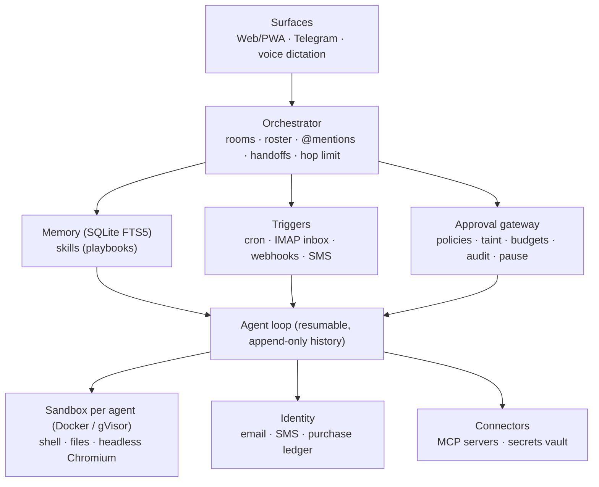

# Troupe

**A self-hosted team of persistent AI agents that runs on one 8 GB Linux VPS.**

Troupe is an open-source alternative that combines the best ideas from Meta Muse, xAI Grok Bot and Manus Cue:

| Idea | Taken from | In Troupe |
|---|---|---|
| Talk to agents like texting a person, in an app *and* a messenger | Muse | Web app (installable PWA, works on phones) + Telegram bot, voice dictation and read-aloud |
| A roster of **named agents with standing roles** | Grok Bot | Create agents like `Chief`, `Scout`, `Courier`, each with its own role, instructions, model and budget |
| **Learn by demonstration** → reusable, schedulable skills | Grok Bot | `/teach name`, walk the agent through it once, `/done` → a saved playbook you can run or schedule |
| **Group chat** where agents share a goal, pass work along, and you make the final call | Cue | Group rooms with a lead agent, a shared plan, `handoff` between agents, @mentions |
| Each agent gets its own **email, phone, wallet, computer** | Cue | Own sandbox computer + plus-addressed email; optional Twilio SMS; budgeted purchase approvals |
| Agents forward/CC-able by email; work starts unprompted | Muse | Inbound email, cron schedules and webhooks all create tasks |

And it fixes the weak spots the blueprint calls out:

- **A real isolation boundary per agent.** Grok Bot's Bots share one cloud computer. In Troupe every agent gets *its own* container (own filesystem, browser profile, processes, optional no-network), and can run under gVisor.
- **Guardrails are built in.** One approval gateway for every action, per-agent permission policies, weekly AI and spending budgets, a full audit log, a global pause button, and **taint tracking**: once a task reads an email, web page or webhook, every outbound action in that task needs your approval, which blunts prompt injection.
- **Honest browsing (the Muse/Amazon lesson).** Agents identify themselves as automated in their user agent, can't type into password fields, and never see secrets. Stored secrets are typed for them, only on domains you allowed, only after you approve.

---

## Architecture



- **One Python process + SQLite.** No Postgres, Redis or vector DB. Memory search is SQLite FTS5.
- **The agent loop is resumable.** History is append-only and saved after every step; tool results are cached per call. A task can wait days for your approval, or survive a reboot, and continue without re-running anything.
- **Sandboxes are lazy and capped.** A container starts on first use, its browser daemon exits after 5 idle minutes, the container stops after 10, and at most `TROUPE_SANDBOX_MAX_ACTIVE` run at once (least-recently-used idle ones are evicted).

### Memory budget on an 8 GB VPS

| Component | Typical RAM |
|---|---|
| OS + Docker daemon | ~0.6 GB |
| Troupe core (FastAPI, SQLite, scheduler) | ~0.15–0.25 GB |
| Each MCP connector (Node servers) | ~0.06–0.1 GB |
| Sandbox, idle (just `sleep`) | ~5 MB |
| Sandbox with Chromium browsing | ~0.4–0.8 GB (hard cap 1 GB each) |
| **Default worst case: 4 browsing sandboxes** | **≤ 4 GB** |
| Headroom (plus a 2 GB swapfile from the installer) | ~2.5 GB |

The model runs in the cloud by default (Claude via the Anthropic API). To run a **local** model with Ollama, use a small one (e.g. a 4B model at Q4, about 3 GB) and set `TROUPE_SANDBOX_MAX_ACTIVE=2`. 8 GB isn't enough for good local tool calling *and* several browsers, so the API is recommended.

---

## Install (Debian 12 / Ubuntu 22.04+)

```bash
git clone <your fork> troupe && cd troupe
sudo ./deploy/install.sh
sudo nano /etc/troupe/troupe.env        # set ANTHROPIC_API_KEY and TROUPE_PUBLIC_URL
sudo systemctl start troupe
sudo -u troupe TROUPE_DATA_DIR=/var/lib/troupe /opt/troupe/.venv/bin/troupe token
```

The installer installs Docker, builds the sandbox image, creates a 2 GB swapfile, adds a hardened systemd unit, and (where the distro has it) installs Caddy. Copy `deploy/Caddyfile` to `/etc/caddy/Caddyfile` with your hostname for automatic HTTPS, then open the site and paste the token. On a phone, use "Add to Home Screen" to install it like an app.

On first start you get a starter team in a **Team** group room: **Chief** (lead / chief of staff), **Scout** (research) and **Courier** (inbox and errands). Each one also has a direct-message room.

### Local development

```bash
python -m venv .venv && . .venv/bin/activate
pip install -e ".[dev]"
TROUPE_SANDBOX=local TROUPE_LLM_PROVIDER=mock python -m troupe   # no API key, no Docker
pytest                                                           # end-to-end tests with a scripted model
```

`TROUPE_SANDBOX=local` runs commands directly on your machine with **no isolation**. Use it only for development.

---

## Using it

**Rooms.** In a DM, the agent answers. In a group room, your message goes to the **lead** unless you `@mention` someone. The lead writes a shared plan (shown at the top of the room), hands pieces to teammates, and their results flow back to it. Agents only interrupt you with `ask_user` for decisions that are really yours. A hop limit per goal (`TROUPE_MAX_HOPS`) stops runaway ping-pong.

**Commands** (web or Telegram):

| Command | Does |
|---|---|
| `@Scout find three quiet hotels` | Address one agent |
| `/teach weekly-report @Courier` … `/done` | Teach a skill by demonstration |
| `/stop` | Stop the tasks in this room |
| `/pause` · `/resume` | Global kill switch |

**Skills.** After `/done`, the agent turns the session (your instructions plus its actual tool calls) into a playbook with `{params}`. Say "use skill weekly-report for week 42", or schedule it from the Skills tab. Agents can also save skills on their own after doing a task well.

**Schedules.** "Every weekday at 8 send me a briefing" works: the agent creates the cron itself. You can manage schedules in the UI too. Cron is in UTC.

**Email with AgentMail (recommended).** Save your [AgentMail](https://agentmail.to) API key in the Vault tab as `agentmail_api_key` (or set `AGENTMAIL_API_KEY`). Within a few seconds every agent gets its own real inbox, such as `troupe-ab12-scout@agentmail.to`, or on your own domain with `TROUPE_AGENTMAIL_DOMAIN`. Mail sent to an agent becomes an untrusted task for it, replies stay in the same thread, and agents can email each other without approval. Troupe checks for new mail every `TROUPE_EMAIL_POLL_SECONDS`, so no public URL or webhook is needed. The key lives in the encrypted vault and never reaches the model.

**Email with your own mailbox.** Set `TROUPE_EMAIL_ADDRESS=me@example.com` plus IMAP/SMTP credentials for any provider that supports plus-addressing (Fastmail, Migadu, Purelymail, self-hosted, Gmail with an app password). The agent `Scout` then is `me+scout@example.com`: forward or CC mail there and it becomes a task. Outbound mail carries an "AI assistant" footer and `Auto-Submitted` header, is rate-limited per agent per day, and goes to non-contacts only with approval. Use a domain with SPF/DKIM/DMARC configured.

**Telegram.** Create a bot with @BotFather, set `TROUPE_TELEGRAM_TOKEN` and your numeric `TROUPE_TELEGRAM_OWNER_ID`. Chat normally; approvals come with ✅/❌ buttons. `/rooms` and `/use <room>` switch rooms.

**Webhooks.** Agents tab → "Webhook URL". POST anything to it (Zapier, n8n, a price-drop alert, an IoT event) and it becomes an untrusted task for that agent.

**SMS (optional).** Twilio number + `TWILIO_*` env vars; point the number's messaging webhook at `https://<host>/hooks/twilio/sms` (signatures are verified). Every outbound SMS needs approval. In the US you must finish A2P 10DLC registration first, and get consent before texting anyone.

**Purchases.** Give an agent a weekly purchase budget and it gets a `request_purchase` tool. Every purchase needs your approval and must fit the budget, and it's recorded in the Purchases list (Vault & system). Payment is **manual**: the agent finds the item and gives you the exact link and details, and you pay yourself. No card number ever reaches an agent.

**Connectors (MCP).** Create `/var/lib/troupe/connectors.json`:

```json
{"mcpServers": {
  "github": {"command": "npx", "args": ["-y", "@modelcontextprotocol/server-github"],
             "env": {"GITHUB_PERSONAL_ACCESS_TOKEN": "vault:github_token"}}
}}
```

Store `github_token` in the Vault tab, restart, and grant access per agent with permissions `{"connectors": {"github": "reads_auto"}}`. `reads_auto` lets read-like tools (`get_*`, `list_*`, `search_*`, …) run freely and asks before anything else.

**Logins on websites.** Save the password in the Vault with its allowed domain (e.g. `example.com`). The agent can then call `type_secret` on that site's password field after you approve it. It never sees the value, and the field refuses plain typing.

---

## Permissions and guardrails

Each agent has a policy per capability: `auto`, `ask` or `deny`.

| Key | Default | Notes |
|---|---|---|
| `network` | `true` | `false` runs the sandbox with no network at all |
| `shell`, `files`, `browser` | `auto` | Contained in the agent's own sandbox |
| `email_send` | `contacts_auto` | Automatic for its contact list, ask for anyone new |
| `sms_send`, `purchase`, `type_secret` | `ask` | Purchases also check the weekly budget |
| `handoff`, `schedule` | `auto` | |
| `connectors` | `{}` | Per MCP server: `auto` / `reads_auto` / `ask` / `deny` |

These rules apply whatever the policy says:

- **Tainted tasks ask.** Inbound email/SMS/webhooks, web pages, shell with network, and connector output mark the task as tainted. After that, every external action (send, pay, type a secret, write via a connector) needs approval.
- **Budgets.** Every model call is costed. An agent that passes its weekly AI budget pauses itself and tells you.
- **Audit.** Every model call, tool call (arguments and result preview), approval, trigger and budget event is in the Activity tab.
- **Limits.** Per-task step cap, per-goal hop cap, per-agent daily email cap, and a 1 GB RAM / 1 CPU / 512 PID cap per sandbox.

### Hardening

- **SSH** is set up by the installer as key-only: no passwords, no root login, at most 3 attempts per connection, with fail2ban banning repeat offenders (1 hour, growing to a week). That makes it reasonable to allow SSH (port 22) from any address in your cloud firewall, which you'll want if your IP changes, for example behind a VPN or proxy. To lock it down further, allow only your own address, or close port 22 and use a private network such as Tailscale.
- Store API keys with `sudo troupe-setkey NAME` (for example `AGENTMAIL_API_KEY`). It reads the key without echoing it, cleans up stray quotes or a pasted `NAME=`, and restarts Troupe.

- **gVisor:** install `runsc`, register it with Docker, and set `TROUPE_SANDBOX_RUNTIME=runsc`. Every agent's syscalls then hit a user-space kernel. This works on VPSes without nested virtualization (unlike Firecracker).
- **Docker access is root-equivalent.** The core needs it to manage sandboxes, so keep the VPS single-purpose, or run Docker rootless and point the `troupe` user at that socket.
- Keep `TROUPE_HOST=127.0.0.1` and expose only Caddy (HTTPS). Rotate the admin token by deleting `/var/lib/troupe/admin_token` and restarting.
- Back up `/var/lib/troupe` (database, vault key, workspaces). Without `vault.key`, stored secrets can't be decrypted.

---

## Model notes

- Default: `claude-opus-5-5` with adaptive thinking, `effort=medium`, automatic prompt caching, Anthropic's server-side web search, and server-side refusal fallback (`TROUPE_FALLBACKS`). Set a cheaper model per agent (e.g. `claude-sonnet-5-5` or `claude-haiku-5-5` for high-volume inbox triage) in the agent editor.
- History is never edited, only appended, so thinking blocks stay valid and caching keeps working. When a room's context passes ~150K tokens, the agent writes a handover note and continues in a fresh thread.
- `openai_compat` works with Ollama, vLLM, LM Studio, OpenRouter and similar. Tool calling quality depends heavily on the model.

---

## Project layout

```
troupe/
  agent.py          resumable agent loop, prompt assembly, tool execution
  orchestrator.py   rooms, routing, handoffs, teach-by-demonstration, dispatcher
  guardrails.py     approval gateway, policies, taint, budgets
  tools.py          built-in tools (shell, files, browser, memory, email, skills, schedules, ...)
  sandbox.py        per-agent Docker/gVisor sandboxes with RAM-aware eviction
  llm.py            Anthropic / OpenAI-compatible / mock providers
  comms.py          email (IMAP/SMTP, plus-addressing) and Twilio SMS
  mcp_connectors.py MCP client for connectors
  triggers.py       cron scheduler, inbox poller
  vault.py          encrypted secrets
  surfaces/         web API + WebSocket, Telegram bot
  static/           web/PWA UI (no build step)
sandbox/            sandbox image + in-sandbox browser helper
deploy/             installer, systemd unit, Caddyfile
tests/              end-to-end tests with a scripted model
```

## Roadmap

- Voice calls (Twilio Media Streams → STT → agent → TTS), with AI disclosure at the start of every call
- WhatsApp Business channel
- Scoped virtual cards for agent purchases (e.g. Stripe Issuing), with real-time authorization against approved purchase intents
- Live "take over the browser" view (noVNC) for logins and CAPTCHAs that you complete yourself
- Per-agent vector memory as an optional add-on

*Not legal or financial advice. Phone, SMS and payments carry real compliance obligations. Check the rules where you live before enabling them.*

License: Apache-2.0
